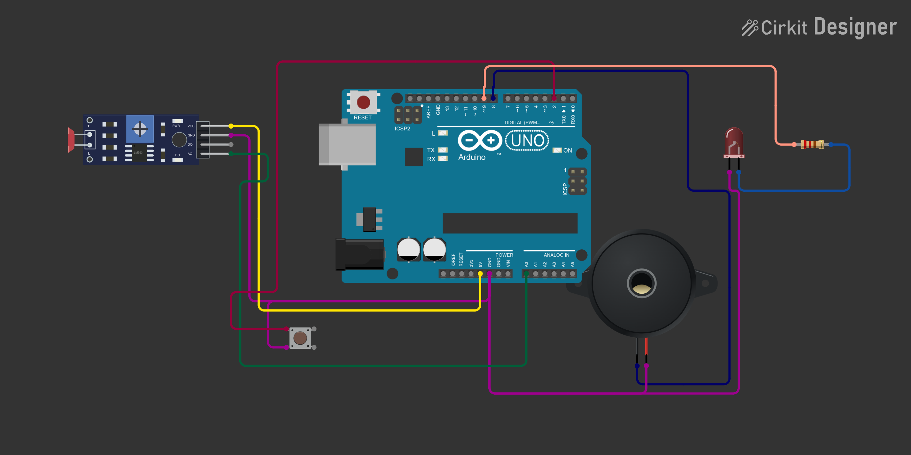

# Отчет по практической работе №5
**Тема:** Аналоговые датчики, analogRead(), map()  
**Студент:** Девлет Максим Керимович  
**Группа:** П-1-24  
**Руководитель по дисциплине:** Белова Дарья Романовна  
**Специальность:** 09.02.07 «Информационные системы и программирование»  
**Образовательное учреждение:** МПТ ФГБОУ ВО «РЭУ им. Г.В. Плеханова»  
**Дата:** «09» ноября 2026 года  

---

### 1. Цель работы
Изучить принципы функционирования аналоговых датчиков и основы аналого-цифрового преобразования (АЦП) на базе 10-разрядного АЦП последовательного приближения (SAR ADC) микроконтроллера ATmega328P платформы Arduino. Освоить практическое применение встроенных функций считывания аналогового напряжения `analogRead()`, ограничения диапазона `constrain()` и линейного масштабирования `map()`. Спроектировать и смоделировать аппаратно-программную систему автомобильного парктроника («датчик парковки») на основе фоторезистора, пьезоизлучателя, светодиода и тактовой кнопки с неблокирующей логикой работы (`millis()`), автоматической 3-секундной калибровкой базового уровня освещенности, зависимостью частоты импульсов от приближения руки, режимом непрерывной аварийной сигнализации («СТОП!») при сближении менее 10% и асинхронным отключением звукового сопровождения через аппаратное прерывание (`attachInterrupt()`).

---

### 2. Схема подключения в эмуляторе
Интерактивный проект схемы доступен в среде Cirkit Designer по ссылке:  
[https://app.cirkitdesigner.com/project/41090fec-b92a-40f8-b21c-a15b956f2572](https://app.cirkitdesigner.com/project/41090fec-b92a-40f8-b21c-a15b956f2572)

#### 2.1. Подключение компонентов
1. **Аналоговый фоторезистор (LDR — датчик приближения):**
   - Включен по схеме резистивного делителя напряжения: один вывод фоторезистора подключен к шине питания `+5V`, второй — к аналоговому входу `A0` микроконтроллера.
   - Точка соединения фоторезистора и пина `A0` соединена через постоянный подтягивающий резистор номиналом 10 кОм с общей шиной `GND`. При отсутствии препятствия (максимальный фоновый свет) сопротивление фоторезистора минимально, и на вход `A0` поступает высокое напряжение. При приближении руки («препятствия») освещенность падает, сопротивление фоторезистора резко возрастает, приводя к падению напряжения на входе `A0`.
2. **Тактовая кнопка (управление звуковым сигналом):**
   - Подключена между цифровым выводом `2` (`BUTTON_PIN`) и общей шиной `GND`.
   - Пин сконфигурирован в режиме `INPUT_PULLUP` с активацией внутренней подтяжки к шине питания. Вывод аппаратно связан с каналом внешних аппаратных прерываний **INT0**, что позволяет регистрировать спадающий фронт (`FALLING`) при нажатии кнопки и оперативно включать/выключать пьезоизлучатель без опроса в цикле.
3. **Пьезоэлектрический зуммер (пьезопищалка):**
   - Положительный контакт подключен к цифровому выводу `8` (`BUZZER_PIN`), отрицательный — к шине `GND`.
   - Звуковой сигнал частотой 2000 Гц генерируется аппаратным таймером через функцию `tone()`, а глушится вызовом `noTone()`.
4. **Светодиод (визуальный дублирующий индикатор):**
   - Анод подключен к цифровому выводу `9` (`LED_PIN`) через токоограничивающий резистор номиналом 220 Ом, катод соединен с шиной `GND`.
   - Светодиод работает синхронно со звуковым импульсом, а при отключении звука кнопкой продолжает функционировать в штатном режиме.
5. **Интерфейс UART (Serial Monitor):**
   - Используется виртуальный COM-порт микроконтроллера на скорости **9600 бод** для вывода сообщений о калибровке, текущего расчетного расстояния в процентах каждые 300 мс и критического предупреждения «СТОП!».

#### 2.2. Таблица распределения выводов и параметров схемы
| Пин Arduino | Подключенный компонент | Назначение и электрическая логика | Режим (Mode) |
| :--- | :--- | :--- | :--- |
| `A0` | Фоторезистор (LDR) + резистор 10 кОм | Делитель напряжения; считывание уровня освещенности (0–1023) | `INPUT` (Analog ADC) |
| `D2` (`INT0`) | Тактовая кнопка (замыкание на GND) | Переключение звука (Mute); внешнее прерывание по спадающему фронту (`FALLING`) | `INPUT_PULLUP` |
| `D8` | Пьезоизлучатель (Buzzer) | Звуковая индикация приближения (импульсы 2000 Гц / непрерывный сигнал) | `OUTPUT` |
| `D9` | Светодиод (LED) через резистор 220 Ом | Световая визуализация импульсов приближения и непрерывная тревога | `OUTPUT` |
| `+5V` / `GND` | Шины питания и заземления | Подача опорного напряжения на делитель фоторезистора и замыкание цепей | Power |
| `UART` | Serial Monitor (COM-порт) | Вывод телеметрии (каждые 300 мс) и статуса калибровки / аварии | 9600 бод |

  
*Рис. 1. Принципиальная схема подключения аналогового парктроника к Arduino Uno в эмуляторе*

---

### 3. Исходный код программы

```cpp
const uint8_t LDR_PIN = A0;
const uint8_t BUTTON_PIN = 2;
const uint8_t BUZZER_PIN = 8;
const uint8_t LED_PIN = 9;

const uint32_t CALIBRATION_MS = 3000UL;
const uint32_t DEBOUNCE_MS = 180UL;
const uint32_t SERIAL_INTERVAL_MS = 300UL;
const uint32_t BEEP_DURATION_MS = 60UL;
const uint16_t TONE_FREQ = 2000U;

uint32_t calibrateStartTime = 0;
uint32_t lastSignalTime = 0;
uint32_t lastSerialTime = 0;

volatile uint32_t lastButtonTime = 0;
volatile bool soundEnabled = true;

int calibratedLight = 0;
int minDark = 0;
uint32_t calibrationSum = 0;
uint16_t calibrationSamples = 0;

bool isCalibrated = false;
bool signalActive = false;

void toggleSound() {
  const uint32_t now = millis();
  if (now - lastButtonTime >= DEBOUNCE_MS) {
    soundEnabled = !soundEnabled;
    lastButtonTime = now;
  }
}

void setup() {
  pinMode(LDR_PIN, INPUT);
  pinMode(BUTTON_PIN, INPUT_PULLUP);
  pinMode(BUZZER_PIN, OUTPUT);
  pinMode(LED_PIN, OUTPUT);
  
  digitalWrite(LED_PIN, LOW);
  noTone(BUZZER_PIN);
  
  Serial.begin(9600);
  calibrateStartTime = millis();
  attachInterrupt(digitalPinToInterrupt(BUTTON_PIN), toggleSound, FALLING);
  
  Serial.println(F("Калибровка освещения: 3 секунды..."));
}

void loop() {
  const uint32_t now = millis();

  if (!isCalibrated) {
    if (calibrationSamples < 60000U) {
      calibrationSum += analogRead(LDR_PIN);
      ++calibrationSamples;
    }

    if (now - calibrateStartTime >= CALIBRATION_MS) {
      if (calibrationSamples == 0) return;
      
      calibratedLight = calibrationSum / calibrationSamples;
      minDark = calibratedLight - 300;
      if (minDark < 0) minDark = 0;
      if (calibratedLight <= minDark) calibratedLight = minDark + 1;
      
      isCalibrated = true;
      Serial.print(F("Калибровка завершена; базовый ADC = "));
      Serial.println(calibratedLight);
    }
    return;
  }

  const int val = analogRead(LDR_PIN);
  const int constrainedVal = constrain(val, minDark, calibratedLight);
  const int distance = map(constrainedVal, minDark, calibratedLight, 0, 100);
  const bool alarm = (distance < 10);

  if (now - lastSerialTime >= SERIAL_INTERVAL_MS) {
    lastSerialTime = now;
    if (alarm) {
      Serial.println(F("СТОП!"));
    } else {
      Serial.print(distance);
      Serial.println(F("%"));
    }
  }

  if (alarm) {
    digitalWrite(LED_PIN, HIGH);
    if (soundEnabled) {
      tone(BUZZER_PIN, TONE_FREQ);
    } else {
      noTone(BUZZER_PIN);
    }
    signalActive = true;
    lastSignalTime = now;
  } else {
    const uint32_t pauseMs = (uint32_t)map(distance, 10, 100, 100, 1000);

    if (signalActive) {
      if (now - lastSignalTime >= BEEP_DURATION_MS) {
        signalActive = false;
        lastSignalTime = now;
        digitalWrite(LED_PIN, LOW);
        noTone(BUZZER_PIN);
      } else if (!soundEnabled) {
        noTone(BUZZER_PIN);
      }
    } else {
      if (now - lastSignalTime >= pauseMs) {
        signalActive = true;
        lastSignalTime = now;
        digitalWrite(LED_PIN, HIGH);
        if (soundEnabled) {
          tone(BUZZER_PIN, TONE_FREQ);
        }
      }
    }
  }
}
```

---

### 4. Краткое описание алгоритма

1. **Инициализация и аппаратные настройки (`setup`)**:
   - Вывод аналогового датчика `LDR_PIN` (A0) переводится в режим входа, вывод кнопки `BUTTON_PIN` (2) конфигурируется с внутренней подтяжкой `INPUT_PULLUP`, пины зуммера (8) и светодиода (9) настраиваются как дискретные выходы (`OUTPUT`).
   - Исходные состояния исполнительных устройств переводятся в пассивный режим: светодиод выключен (`digitalWrite(LED_PIN, LOW)`), генератор звука остановлен (`noTone(BUZZER_PIN)`).
   - Инициализируется UART-соединение на скорости 9600 бод, фиксируется метка старта калибровки `calibrateStartTime = millis()`.
   - Функция `attachInterrupt(digitalPinToInterrupt(BUTTON_PIN), toggleSound, FALLING)` привязывает процедуру обработки внешнего прерывания INT0 к спадающему фронту сигнала при нажатии кнопки.

2. **Адаптивная автокалибровка фонового уровня освещенности (первые 3 секунды)**:
   - В течение 3000 мс (`CALIBRATION_MS`) программа накапливает сумму отсчетов АЦП `calibrationSum` и количество измерений `calibrationSamples` (с защитой от переполнения до 60000 выборок).
   - По истечении 3 секунд вычисляется математическое среднее `calibratedLight = calibrationSum / calibrationSamples`, фиксирующее базовый уровень освещенности помещения в состоянии «свободно».
   - Нижний порог затемнения вычисляется адаптивно: `minDark = calibratedLight - 300` (с защитой от отрицательных значений и контролем валидности диапазона).
   - Устанавливается флаг готовности `isCalibrated = true`, и в Serial-монитор отправляется информационное сообщение со значением базового отсчета.

3. **Считывание показаний, нормализация и масштабирование**:
   - Функция `analogRead(LDR_PIN)` считывает текущий 10-разрядный код АЦП (0–1023).
   - Значение жестко ограничивается границами калиброванного диапазона с помощью `constrain(val, minDark, calibratedLight)` для исключения выхода за пределы допустимых значений при изменении внешней освещенности.
   - Функция `map(constrainedVal, minDark, calibratedLight, 0, 100)` преобразует напряжение в условное расстояние от 0% («рука вплотную») до 100% («препятствия нет»).
   - Формируется логический флаг аварийного сближения `alarm = (distance < 10)`.

4. **Интервальный вывод телеметрии в COM-порт (каждые 300 мс)**:
   - С помощью неблокирующего сравнения таймеров `now - lastSerialTime >= SERIAL_INTERVAL_MS` организуется регулярный вывод состояния без использования блокирующей функции `delay()`.
   - Если активирован режим тревоги (`alarm == true`), в порт выводится предупреждение `СТОП!`.
   - В штатном режиме парковки передается текущее расстояние в процентах (например, `85%`, `42%`).

5. **Управление светозвуковой сигнализацией**:
   - **Критический режим (`distance < 10%`):** светодиод зажигается непрерывно (`digitalWrite(LED_PIN, HIGH)`), при разрешенном звуке непрерывно работает пьезозуммер `tone(BUZZER_PIN, TONE_FREQ)`, флаг активности переводится в `true`, а таймер сбрасывается для бесшовного возврата в прерывистый режим.
   - **Динамический прерывистый режим (`distance >= 10%`):** длительность паузы между короткими импульсами пересчитывается динамически: `pauseMs = map(distance, 10, 100, 100, 1000)`. При 100% («далеко») пауза составляет 1000 мс, при приближении к 10% сокращается до 100 мс.
   - Длительность звучания каждого импульса строго фиксирована константой `BEEP_DURATION_MS = 60UL`. Светодиод и зуммер включаются одновременно. Если во время импульса кнопкой отключается звук, зуммер немедленно глушится вызовом `noTone()`, а светодиод продолжает отработку импульса.

6. **Асинхронная обработка прерывания кнопки (`toggleSound`)**:
   - При замыкании кнопки срабатывает аппаратное прерывание INT0.
   - Программный фильтр антидребезга `now - lastButtonTime >= DEBOUNCE_MS` (180 мс) отсекает ложные дребезги контактов.
   - Логический флаг `soundEnabled` инвертируется. Переменная объявлена с модификатором `volatile`, предотвращающим кэширование в регистрах процессора и обеспечивающим атомарную видимость флага в основном цикле программы.

---

### 5. Вывод
В ходе выполнения практической работы были всесторонне изучены и закреплены принципы работы с аналоговыми сенсорами и преобразованием сигналов в микроконтроллерах ATmega328P:
1. Собрана и промоделирована в среде Cirkit Designer схема аналогового парктроника на базе платформы Arduino Uno, включающая фоторезистивный делитель напряжения на входе `A0`, тактовую кнопку с аппаратным прерыванием INT0 (`D2`), пьезоизлучатель (`D8`) и светодиод (`D9`).
2. Освоено применение встроенных функций аналоговой подсистемы Arduino: `analogRead()` для дискретизации напряжения, `constrain()` для фильтрации выбросов за пределы диапазона и `map()` для математического масштабирования аналоговых величин в процентную шкалу расстояния и длительности временных пауз.
3. Разработан и протестирован полностью неблокирующий алгоритм на основе системного таймера `millis()`, реализующий адаптивную 3-секундную калибровку датчика под условия окружающего освещения, динамическое учащение звуковых и световых сигналов при сближении с препятствием (от 1000 до 100 мс), непрерывный сигнал тревоги «СТОП!» при дистанции менее 10% и отправку телеметрии в COM-порт каждые 300 мс.
4. Реализовано независимое управление звуковым каналом через внешнее аппаратное прерывание кнопки с квалификатором `volatile` и подавлением дребезга контактов, сохраняющее непрерывную работу световой индикации.

